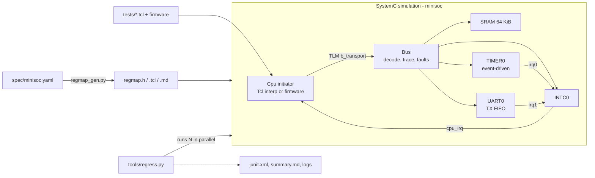

# MiniSoC: a scriptable SystemC/TLM-2.0 virtual prototype with CI regression

[](https://github.com/udayramageri09/minisoc/actions/workflows/ci.yml)

**Problem.** Firmware teams usually wait for silicon or an FPGA board before they
can write and test drivers, and debug can take up to 40% of project time.
Virtual prototypes fix this by modelling the hardware in SystemC TLM-2.0, so
software runs and gets tested months early, automatically, in CI. That's the
"shift-left" idea behind tools like Synopsys Virtualizer.

MiniSoC is that workflow on a small scale, built from free, standard parts
(Accellera SystemC 2.3.4, Tcl 8.6, Python):

* **One spec, everything generated.** `spec/minisoc.yaml` describes the address map,
  registers, fields and IRQs. `tools/regmap_gen.py` checks it (overlapping regions,
  misaligned offsets, overlapping fields, duplicate IRQs) and generates
  `regmap.h` (for the models and firmware), `regmap.tcl` (for the tests) and
  `regmap.md` (for people).
* **SystemC TLM-2.0 platform.** A CPU initiator, an address-decoding bus (binary-search
  decode, CSV transaction trace, fault injection), SRAM, a UART with an 8-deep TX FIFO,
  an event-driven timer and a level-sensitive interrupt controller.
* **Two kinds of software run on it:** Tcl test scripts (`vp_read`, `vp_write`,
  `vp_wait_irq`, ...) and firmware drivers written against a HAL (`firmware/`).
* **Regression and triage.** `tools/regress.py` runs tests in parallel and sorts each
  result into PASS / FAIL / ERROR / SIM_TIMEOUT / HANG / CRASH. It groups failures by
  normalised signature and writes JUnit XML for CI.
* **CI.** GitHub Actions runs a normal build and an ASan+UBSan build on every push.
* **Agentic development.** `CLAUDE.md` holds the project rules, and two skills
  (`add-peripheral`, `triage-regression`) give AI coding agents repeatable workflows.

## Architecture



Memory map (generated into `build/generated/regmap.md`):

| Region | Base | Size | IRQ |
|---|---|---|---|
| SRAM | 0x00000000 | 64 KiB | - |
| UART0 | 0x10000000 | 4 KiB | 1 |
| TIMER0 | 0x10001000 | 4 KiB | 0 |
| INTC0 | 0x10002000 | 4 KiB | - |

## Quick start (Ubuntu 24.04)

```bash
sudo apt-get install -y libsystemc-dev tcl-dev cmake g++ python3-yaml python3-pytest
scripts/check.sh                 # unit tests + build + full regression
scripts/check.sh --asan          # same, with AddressSanitizer + UBSan
build/minisoc --fw timer_irq      # run one firmware image
build/minisoc --script tests/test_timer.tcl --trace out/timer.csv
python3 tools/regress.py --tags irq
```

Expected output of `build/minisoc --fw timer_irq`:

```
[uart0 @17024 ns] tick 1
...
[uart0 @57024 ns] tick 5
TEST PASSED
```

## Design decisions (and why)

| Decision | Reason |
|---|---|
| Loosely-timed blocking transport (`b_transport`) | Software-centric prototypes care about functional correctness and rough timing. LT runs orders of magnitude faster than cycle-accurate models. |
| Timer schedules one expiry event | No per-tick process, so simulation cost doesn't depend on how long the timer runs. `VALUE` is computed from `sc_time_stamp()`. |
| Single writer per signal | SystemC's default writer policy forbids two processes driving one signal. Register writes notify an event, and one `SC_METHOD` drives the IRQ. |
| `RegPeripheral` base class + virtual `reg_read/reg_write` | Protocol checks (alignment, length, byte enables) live in one place. Each peripheral only describes its registers. |
| Bus keeps regions sorted and decodes with `upper_bound` | O(log n) decode. Overlaps are rejected when the platform is built, not discovered at runtime. |
| Register map generated from YAML | Models, firmware and tests can't drift apart, and spec mistakes are caught before compiling. |
| Tcl as the test language | Simulation control and test scripting in EDA tools is traditionally Tcl. Bus errors surface as Tcl errors, so tests can `catch` them. |
| Exit codes + log markers, then bucketing | A regression with 50 red tests usually has 2-3 root causes. Bucketing shows them directly. |

## Known limitations (deliberate, for a 1-day build)

* The CPU is a transaction generator, not an instruction-set simulator. Firmware is
  host-compiled against `hal.h`. A real VDK runs the unmodified target binary on an ISS.
  The next step would be plugging in a RISC-V ISS behind the same socket.
* No temporal decoupling: the CPU calls `wait(delay)` after every access, which is
  exact but slower. Adding `tlm_utils::tlm_quantumkeeper` is the standard speed-up.
* Targets use `sc_time_stamp()` and ignore the annotated `delay`, so their time is a
  few ns early. That's acceptable at this level of timing accuracy.
* No DMI (direct memory interface) for SRAM.

## Bugs found while building it

See [docs/DEBUG_LOG.md](docs/DEBUG_LOG.md): a test too weak to catch an off-by-one
(found by mutation testing), a coroutine stack overflow, and a sanitizer
incompatibility with SystemC threads.

## Layout

```
spec/            platform YAML (source of truth)
tools/           regmap_gen.py, regress.py, pytest unit tests
src/             SystemC models: bus, memory, peripherals, cpu (+Tcl bridge), main
firmware/        HAL, drivers, firmware images
tests/           Tcl tests, lib.tcl helpers, regression.yaml manifest
scripts/         build.sh, check.sh, debug.sh
.github/         CI workflow (normal + ASan matrix)
.claude/skills/  agent workflows; CLAUDE.md holds the project rules
```
